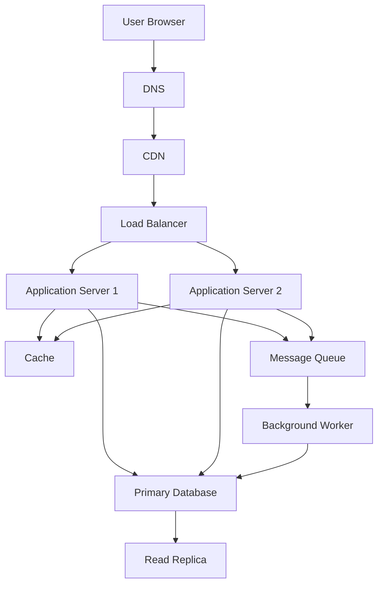

# QuickNotes System Architecture

## 1. Overview

QuickNotes is a web-based note-taking system. Its architecture separates the front end, application servers, caching, background processing, and database storage so that each component can scale as usage grows.

## 2. Functional Requirements

- Users can register and log in securely.
- Users can create, view, update, and delete their notes.
- Users can search for notes and filter them by tags.
- Users can only access notes they are authorized to view.
- The system displays clear loading, success, empty, and error states.

## 3. Non-Functional Requirements

- Availability: The service should remain available when one application server fails.
- Performance: Common note-reading requests should respond quickly under normal load.
- Security: Passwords must be hashed, and communication must use HTTPS.
- Scalability: Components should support increasing users and requests.
- Reliability: Backups and recovery procedures should protect stored notes.
- Maintainability: Components should be separated so they can be tested and updated independently.

## 4. High-Level Architecture



## 5. Component Responsibilities

- **User Browser:** Displays the interface and sends API requests.
- **DNS:** Resolves the website domain to the appropriate network address.
- **CDN:** Delivers static files such as CSS, JavaScript, and images from nearby locations.
- **Load Balancer:** Distributes incoming requests across healthy application servers.
- **Application Servers:** Validate requests, enforce authorization, and execute application logic.
- **Cache:** Stores frequently accessed data temporarily to reduce database reads.
- **Primary Database:** Stores authoritative user, note, and tag data and handles writes.
- **Read Replica:** Copies database changes from the primary and can serve suitable read queries.
- **Message Queue:** Holds background jobs until workers process them.
- **Background Worker:** Performs tasks such as sending notifications or processing exports without blocking user requests.

## 6. Scaling Estimates for One Million Users

These estimates are planning assumptions, not measured production traffic.

### Assumptions

- Total registered users: 1,000,000.
- Daily active users: 10% of registered users, or 100,000.
- Each active user reads 50 notes per day.
- Each active user creates one note per day.
- Average stored note content and metadata: approximately 2 KB.
- A peak traffic factor of 5 times average traffic is used for reads.

### Read Requests

Daily reads:

100,000 active users × 50 reads = 5,000,000 reads/day.

Average reads per second:

5,000,000 ÷ 86,400 ≈ 58 reads/second.

Estimated peak reads:

58 × 5 ≈ 290 reads/second.

### Write Requests

Daily writes:

100,000 active users × 1 note = 100,000 writes/day.

Average writes per second:

100,000 ÷ 86,400 ≈ 1.16 writes/second.

This estimate counts note creation only. Updates, deletes, authentication, and other database operations would increase the total workload.

### Storage per Year

Daily note storage:

100,000 notes × 2 KB = approximately 200 MB/day.

Annual note storage:

200 MB × 365 = approximately 73 GB/year.

This excludes indexes, backups, database replicas, logs, and other application data. Actual storage depends on note sizes and user activity.

## 7. Request Flows

### GET /notes

1. The browser sends a `GET /notes` request over HTTPS.
2. The load balancer forwards it to a healthy application server.
3. The server authenticates the user and checks authorization.
4. The server checks the cache for the requested notes.
5. If cached data is unavailable, the server queries the database or an appropriate read replica.
6. The server returns a JSON response to the browser.
7. The client displays the notes and updates the status message.

### POST /notes

1. The browser sends a `POST /notes` request with a JSON title and body.
2. The load balancer forwards the request to an application server.
3. The server authenticates the user and validates the input.
4. The server writes the new note to the primary database.
5. The server invalidates or updates relevant cached data.
6. The server returns `201 Created` with the new note.
7. The client displays the created note and a success message.

## 8. Architecture Trade-offs

### Cache vs Freshness

Caching improves read performance and reduces database load. However, cached data can become stale. The system should invalidate or update relevant cache entries after changes.

### Read Replicas vs Consistency

Read replicas can distribute read traffic, but replication may introduce a delay before recent writes appear. Requests requiring immediate confirmation should read from the primary database when appropriate.

### Background Jobs vs Simplicity

A message queue keeps slow tasks away from user-facing requests. However, queues and workers add operational complexity and need retry handling.

## 9. Avoiding Single Points of Failure

- Run at least two application servers behind a health-checking load balancer.
- Use database backups and a tested recovery procedure.
- Configure database replication and a documented failover process.
- Deploy the cache and message queue with appropriate redundancy for their importance.
- Monitor errors, latency, server health, and storage capacity.
- Test recovery plans regularly rather than relying on backups alone.

## 10. Conclusion

A layered architecture allows QuickNotes to grow from a small practice project into a more scalable service. The actual infrastructure should be selected after load testing, measuring costs, and confirming real usage patterns.
```

### Step 12: Confirm the three design documents

Your `docs` folder should now contain:

- `api-design.md`
- `data-model.md`
- `architecture.md`

Save the file and reply **next**. We’ll create the `README.md`, then start checking and committing your work to GitHub.